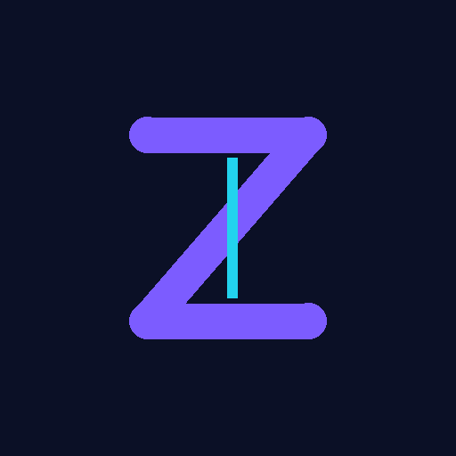

<div align="center">



# Zekai

### A free and open source manga reader for Android

Discover and read manga, webtoons, comics, and more on your Android device.

[](https://github.com/zeeks024/zekai/actions/workflows/build.yml)
[](/LICENSE)

</div>

Zekai is a fork of [Mihon](https://github.com/mihonapp/mihon), maintained separately. It keeps the reader, library, tracking, and backup features of the upstream project, with its own name, package ID (`com.zekslab.zekai`), launcher icon, and default theme.

Zekai is not affiliated with or endorsed by the Mihon project. The developer of this application has no affiliation with the content providers available, and this application hosts zero content.

## Status

There is no official release yet. Builds from this repository are the only builds of Zekai. Do not install an APK that claims to be Zekai from any other source.

Requires Android 8.0 or higher.

## Features

* Local reading of content.
* A configurable reader with multiple viewers, reading directions, and other settings.
* Tracker support: [MangaBaka](https://mangabaka.org), [MyAnimeList](https://myanimelist.net/), [AniList](https://anilist.co/), [Kitsu](https://kitsu.app/), [MangaUpdates](https://mangaupdates.com), [Shikimori](https://shikimori.one), [Bangumi](https://bgm.tv/), and [Hikka](https://hikka.io/).
* Categories to organize your library.
* Light and dark themes.
* Schedule updating your library for new chapters.
* Create backups locally to read offline or to your desired cloud service.

## Build from source

Prerequisites: Android Studio, and an emulator or a phone with developer options enabled.

```bash
git clone https://github.com/zeeks024/zekai.git
cd zekai
./gradlew assembleDebug
```

The debug APK is written to `app/build/outputs/apk/debug/`. For a release build, see [CONTRIBUTING.md](CONTRIBUTING.md).

Notes on this fork:

* The in-app update checker points at this repository's releases. It reports no update until a release is published here.
* Telemetry and crash reporting are off by default. This fork has no Firebase project configured, so no analytics or crash data is sent anywhere. Telemetry can only be enabled explicitly with `-Pinclude-telemetry` together with a Firebase configuration for this package.
* The upstream donation prompt and Support Us screen are removed. Zekai does not collect donations.

## Issues and contributing

Report a bug or request a feature in [Issues](https://github.com/zeeks024/zekai/issues). Pull requests are welcome. Before opening a pull request, read [CONTRIBUTING.md](CONTRIBUTING.md).

Translations for the strings this project shares with upstream are managed upstream via Weblate. New strings added only in Zekai should be added in English in `i18n/src/commonMain/moko-resources/base/strings.xml`.

## Credits

Zekai builds on the work of the [Mihon Open Source Project](https://github.com/mihonapp/mihon) and, before it, Tachiyomi. Thank you to all the people who contributed to those projects. See the [LICENSE](LICENSE) file and the in-app open source licenses screen for full attribution.

## Disclaimer

The developer of this application does not have any affiliation with the content providers available, and this application hosts zero content.

## License

```
Copyright © 2015 Javier Tomás
Copyright © 2024 Mihon Open Source Project

Licensed under the Apache License, Version 2.0 (the "License");
you may not use this file except in compliance with the License.
You may obtain a copy of the License at

http://www.apache.org/licenses/LICENSE-2.0

Unless required by applicable law or agreed to in writing, software
distributed under the License is distributed on an "AS IS" BASIS,
WITHOUT WARRANTIES OR CONDITIONS OF ANY KIND, either express or implied.
See the License for the specific language governing permissions and
limitations under the License.
```
